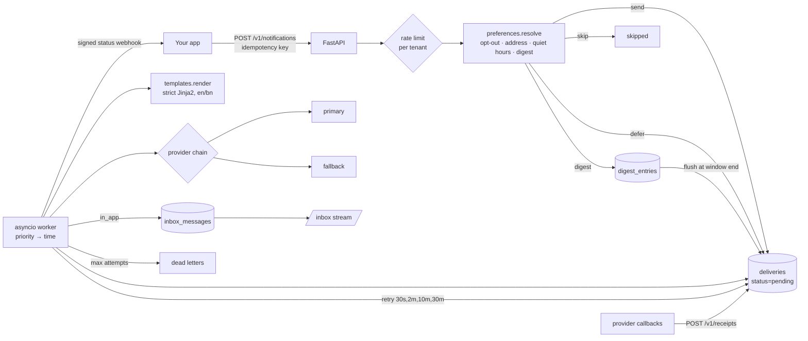

<!-- topics: notifications,fastapi,python,email,sms,push,in-app,jinja2,sse,asyncio,sqlalchemy,multi-tenant -->
# notification-service

A multi-tenant notification service for email, SMS, push, in-app and webhook channels: versioned Jinja2 templates in English and Bangla, per-category preferences with quiet hours (Asia/Dhaka aware) and hourly/daily digests, idempotent intake with per-tenant rate limits, an asyncio worker with priority queues, provider fallback chains, retries with backoff and dead letters, signed delivery-status webhooks, and a realtime in-app inbox over Server-Sent Events.

[](https://github.com/AkibUllah/notification-service/actions/workflows/ci.yml)


## Try it live

| | |
|---|---|
| API reference | https://akibullah.github.io/notification-service/ — Swagger UI built from the exported OpenAPI document (static; no backend behind it) |
| Run in your browser | [](https://codespaces.new/AkibUllah/notification-service?quickstart=1) — starts API + worker + PostgreSQL with `docker compose`, creates tenant "Dhaka Grocers" (key in `.demo-tenant.txt`), user `u-42`, an in-app template and sends one notification; open forwarded port 8000 at `/docs` and read `GET /v1/inbox/u-42` with the tenant key (admin key `change-me`). |
| One-click deploy | [](https://render.com/deploy?repo=https://github.com/AkibUllah/notification-service) — `render.yaml` provisions the web service (worker in-process) and a free PostgreSQL; `ADMIN_API_KEY` is generated. |
| Local | `docker compose up` (see Quick Start) |

## Why this exists

Every product I have worked on grew the same tangle: an `send_email()` helper here, an SMS aggregator call there, a push token table nobody cleaned up, and a customer who got the same "order shipped" message four times at 2am because a retry loop had no memory. Bangladesh adds its own wrinkles: SMS is still the channel people actually read, bKash-style OTPs must go out immediately while marketing must not wake anyone, and templates need a Bangla variant that is not an afterthought. This service puts all of that behind one `POST /v1/notifications`: the caller says *what* happened and to *whom*; preferences, templates, channel fallbacks, timing and retries are the service's job.

## Features

- Channels: email, SMS, push, in-app inbox and user webhooks, each with a `Provider` protocol; console email/SMS and a JSON-lines push file for development, clearly labelled stubs for SMTP (`aiosmtplib`), a Bangladeshi SMS aggregator (HTTP) and FCM v1
- Fallback chains per channel with health tracking: a provider that fails N times in a row is skipped for a cooldown, then probed again; the chain never drops a message just because every provider is cooling down
- Templates: versioned per `(key, channel, locale)`, en/bn with default-locale fallback, sandboxed Jinja2 with `StrictUndefined`; the template declares its variables and saving rejects undeclared references, rendering rejects missing or unexpected ones; built-ins `user`, `unsubscribe_url`, `now`; preview endpoint
- Preferences per category with a `*` catch-all: channel opt-in/out, quiet hours in the user's timezone (overnight windows handled), hourly/daily digests; high priority bypasses quiet hours and digests (OTPs, fraud alerts); one-click unsubscribe tokens, scoped to a category and/or channel
- Intake: single and bulk `POST /v1/notifications`, idempotency keys (replay returns the original with `200` + `X-Idempotent-Replay`), sliding-window rate limit per tenant with `Retry-After`, template resolution at accept time so a typo fails the request, not the worker
- Worker: due deliveries by priority then time, retries at 30s/2m/10m/30m (configurable), dead letters after `MAX_ATTEMPTS`, non-retryable failures (bad address, unregistered push token, render error) go straight to dead letters; replay endpoint; runs in-process or as `python -m notifications.worker`
- Digest scheduler groups batched notifications per user, category and channel and flushes them at the top of the hour or at 09:00 local, using the tenant's `digest` template or a built-in bilingual list
- Delivery status: HMAC-signed `delivery.sent` / `delivery.dead` webhooks to the tenant; inbound receipts (`delivered`, `bounced`, `read`, …) matched by provider message id
- In-app inbox: list, unread count, mark read, and `GET /v1/inbox/{user}/stream` SSE with `ready`, `message` and `read` events
- Multi-tenant with hashed API keys; admin API for tenants, provider health, dead letters and manual worker runs; SQLite for dev/tests, PostgreSQL via docker compose

## Architecture



Design notes:

- **Resolution happens once, at intake.** `preferences.resolve()` turns a request into per-channel decisions (send / defer / digest / skip with a reason) and the API persists one `Delivery` row per decision. The worker never has to re-derive policy, and the caller sees immediately that SMS was skipped because the user opted out.
- **Deliveries are the queue.** `status='pending' AND next_attempt_at <= now` is the work list, ordered by priority rank then time. A quiet-hours deferral is just a delivery with `next_attempt_at` set to 08:00 local, so there is no second scheduler to keep consistent.
- **Templates are contracts.** Declared variables are checked both when a template is saved (no undeclared references) and when it is rendered (nothing missing, nothing extra). Rendering runs in Jinja2's sandbox with `StrictUndefined`, so a typo produces an error instead of a blank in a customer's SMS.
- **Providers are swappable and watched.** The chain records consecutive failures per provider and opens a small circuit; `/v1/providers` and `/health` expose that state. Non-retryable results stop the chain early because no other provider will fix an invalid address.
- **Time is injected.** Quiet hours, digest windows, retry timing and rate limiting all read the app clock; tests use a `FixedClock` and the worker is driven by `process_once(now)`.
- **Status is pushed, not polled.** Tenants get signed webhooks for terminal delivery states and users get SSE for inbox changes; both reuse the HTTP transport so tests run them against an in-memory receiver.

## Tech Stack

| Layer | Choice |
| --- | --- |
| API | FastAPI, Pydantic v2, `StreamingResponse` for SSE |
| Templates | Jinja2 `SandboxedEnvironment` + `StrictUndefined`, `jinja2.meta` for variable discovery |
| Persistence | SQLAlchemy 2.0; SQLite (dev/tests), PostgreSQL 16 (compose, psycopg 3) |
| Worker | asyncio loop (in-process or standalone), async `Provider` protocol, httpx for HTTP providers |
| Time | `zoneinfo` (Asia/Dhaka), injectable clock |
| Tooling | pytest + pytest-asyncio + coverage, ruff, Makefile, GitHub Actions (3.10/3.11 + docker build) |

## Quick Start

### Docker Compose (API + dedicated worker + PostgreSQL)

```bash
git clone https://github.com/AkibUllah/notification-service.git && cd notification-service
cp .env.example .env
docker compose up --build -d
curl -s localhost:8000/health
```

### Local (SQLite, worker inside the API)

```bash
make install
make dev                               # http://127.0.0.1:8000, docs at /docs
```

Create a tenant, a user, templates, and send:

```bash
ADMIN=(-H "X-API-Key: change-me" -H "Content-Type: application/json")
curl -s -X POST localhost:8000/v1/tenants "${ADMIN[@]}" \
  -d '{"name":"Dhaka Grocers","webhook_url":"https://shop.example.com/notify-status"}'
# -> {"api_key":"ntk-…","webhook_secret":"…"}  (shown once)

T=(-H "X-API-Key: ntk-…" -H "Content-Type: application/json")
curl -s -X PUT localhost:8000/v1/users "${T[@]}" -d '{"external_id":"u-42","name":"Akib",
  "email":"akib@example.com","phone":"+8801711000000","locale":"bn",
  "quiet_hours_start":"22:00","quiet_hours_end":"08:00"}'

curl -s -X POST localhost:8000/v1/templates "${T[@]}" -d '{"key":"order-shipped","channel":"sms","locale":"en",
  "body":"Order {{ order_id }} shipped. {{ amount }}","variables":["order_id","amount"]}'
curl -s -X POST localhost:8000/v1/templates "${T[@]}" -d '{"key":"order-shipped","channel":"sms","locale":"bn",
  "body":"অর্ডার {{ order_id }} পাঠানো হয়েছে। {{ amount }}","variables":["order_id","amount"]}'
curl -s -X POST localhost:8000/v1/templates "${T[@]}" -d '{"key":"order-shipped","channel":"in_app","locale":"en",
  "subject":"Order {{ order_id }} shipped","body":"{{ amount }} · tap to track","variables":["order_id","amount"]}'

curl -s -X POST localhost:8000/v1/notifications "${T[@]}" -d '{"user":"u-42","category":"orders",
  "template":"order-shipped","variables":{"order_id":"ORD-4521","amount":"৳1,500.00"},
  "channels":["sms","in_app"],"idempotency_key":"order-4521-shipped"}'
# 202 -> deliveries: sms pending (or deferred to 08:00 if it is night in Dhaka), in_app pending

curl -s localhost:8000/v1/inbox/u-42/unread-count "${T[@]}"
curl -sN localhost:8000/v1/inbox/u-42/stream "${T[@]}"          # SSE
curl -s -X POST "localhost:8000/v1/worker/run-once" "${ADMIN[@]}"  # when WORKER_ENABLED=false
```

Preferences and digests:

```bash
curl -s -X PUT localhost:8000/v1/users/u-42/preferences "${T[@]}" \
  -d '{"category":"marketing","channels":{"sms":false},"digest":"daily"}'
curl -s -X POST "localhost:8000/v1/users/u-42/unsubscribe-token?category=marketing" "${T[@]}"
```

## API

Tenant routes take the tenant's `X-API-Key`; admin routes take `ADMIN_API_KEY`. Errors are `{"error": {"code", "message"}}`; `429` carries `Retry-After`.

| Method | Path | Purpose |
| --- | --- | --- |
| `POST` · `GET` | `/v1/tenants` | Admin: create (key and webhook secret shown once) / list |
| `GET` | `/v1/providers` | Admin: provider chains with health, counters, cooldowns |
| `GET` | `/v1/dead-letters` | Admin: deliveries that exhausted retries (`channel` filter) |
| `POST` | `/v1/deliveries/{id}/replay` | Admin: requeue a dead, sent or skipped delivery |
| `POST` | `/v1/worker/run-once` | Admin: flush due digests and process due deliveries now |
| `PUT` · `GET` | `/v1/users` · `/v1/users/{external_id}` | Upsert (addresses, locale, timezone, quiet hours) / list / fetch |
| `PUT` | `/v1/users/{external_id}/preferences` | `{category, channels: {sms: false}, digest: hourly|daily|none}` |
| `POST` | `/v1/users/{external_id}/unsubscribe-token` | Scoped token + public URL (`category`, `channel` optional) |
| `GET` | `/v1/unsubscribe/{token}` | Public one-click unsubscribe page |
| `POST` · `GET` · `DELETE` | `/v1/templates[/{id}]` | Create a new version / list (`key` filter) / deactivate |
| `POST` | `/v1/templates/render` | Preview with variables, locale fallback, optional user |
| `POST` | `/v1/notifications` | Queue one (`202`; idempotent replay `200`) |
| `POST` | `/v1/notifications/bulk` | Up to 500; per-item success or error |
| `GET` | `/v1/notifications[/{id}]` | List (`user`, `status`, `X-Total-Count`) / detail with deliveries |
| `GET` | `/v1/deliveries` | Filter by `status`, `channel` |
| `POST` | `/v1/receipts` | `{provider_message_id, status}` from provider callbacks |
| `GET` | `/v1/inbox/{external_id}` | Messages (`unread`, `limit`, `before`) |
| `GET` · `POST` | `/v1/inbox/{external_id}/unread-count` · `/read` | Count / mark some or all read |
| `GET` | `/v1/inbox/{external_id}/stream` | SSE: `ready`, `message`, `read` events |
| `GET` | `/health` | DB, worker state, provider health, SSE subscribers, clock |

Status webhook: `POST` to the tenant URL with `X-Notify-Signature: t=<ts>,v1=<hmac-sha256>` over `"<ts>.<body>"` and body `{"type": "delivery.sent" | "delivery.dead", "data": {delivery…}}`. Verify with `notifications.core.signing.verify`.

## Project Structure

```
notifications/
├── main.py                 # app factory + in-process worker loop
├── worker.py               # python -m notifications.worker
├── clock.py · config.py · database.py · models.py · schemas.py
├── core/                   # pure helpers: channels, quiet_hours, digest windows, retry, ratelimit, signing
├── providers/
│   ├── base.py             # Message, ProviderResult, Provider protocol
│   ├── chain.py            # fallback chain with health tracking
│   ├── fakes.py            # console email/SMS, file push, scriptable FakeProvider
│   ├── http.py             # webhook channel, BD SMS aggregator stub, FCM stub
│   ├── smtp.py             # aiosmtplib stub
│   └── registry.py         # chains from settings
├── services/
│   ├── notifications.py    # intake: idempotency, rate limit, resolution, queueing
│   ├── preferences.py      # channel/category/quiet-hours/digest resolution, unsubscribe
│   ├── templates.py        # versions, locale fallback, strict render
│   ├── worker.py           # process_once, retries, dead letters, replay, receipts
│   ├── digests.py · inbox.py · status_webhooks.py · tenants.py · bus.py
└── api/                    # admin.py, tenant_api.py, inbox_api.py
tests/                      # 48 tests; FixedClock, FakeProvider chains, httpx.MockTransport receiver
```

## Testing

```bash
make test        # pytest (48 tests, in-memory SQLite, no network)
make cov         # with coverage (94% at the time of writing)
make lint        # ruff check + format check
```

Covered: template contracts (undeclared / missing / unexpected variables, syntax errors, sandbox escapes, locale fallback, versioning and deactivation); preference resolution (catch-all vs category, missing addresses, opt-outs, unsubscribe tokens); quiet hours in Asia/Dhaka including overnight windows, end-time computation, deferral and high-priority bypass; digest window keys and flush times, hourly batching flushed exactly once, tenant digest templates in Bangla, grouping per user/category/channel; provider fakes and file output, chain fallback, circuit open/recover, all-unhealthy behaviour, non-retryable short-circuit, stub configuration errors and request shapes for the BD SMS and FCM stubs; the worker end to end across all five channels, priority ordering and batch size, backoff schedule to dead letter and replay, fallback provider use, render errors, idempotency, rate limiting, quiet-hours release, receipts; and the HTTP API (auth, users, preferences, unsubscribe page, templates and preview, notification flow with idempotent replay, inbox operations, bulk partial failures, 429 handling, dead letters, provider health, inbox SSE, signed status webhooks).

## Roadmap

- `SELECT … FOR UPDATE SKIP LOCKED` claiming so multiple worker replicas share one PostgreSQL queue
- Redis-backed rate limiter and inbox bus for multi-instance deployments
- Attachments and inline images for email; rich push payloads (images, actions)
- Per-tenant provider configuration and per-channel sending windows
- Alembic migrations (schema is created with `create_all` today)

## License

MIT — see [LICENSE](LICENSE).
